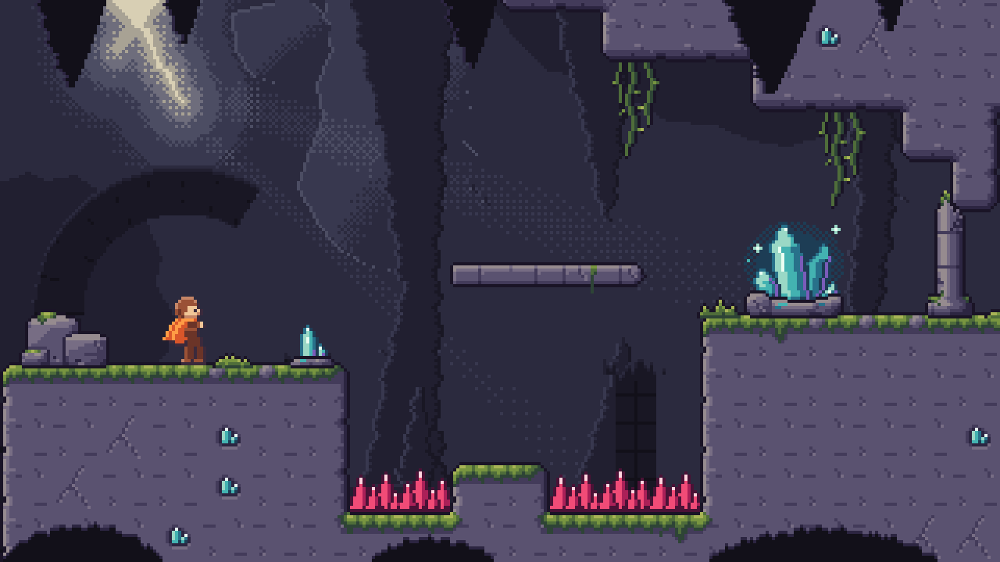

# Test 16 — Kit de niveau « Grotte des Échos cristallins »

Un kit complet pour un jeu de plateforme en vue de profil, tuiles de 16 px, écran 320×180.
Il applique METHODE_PIXEL_ART.md v15 du début à la fin. Chaque pixel est décidé dans un
fichier `.txt` (une lettre = une couleur de `palette.json`). Les scripts ne font que
recoller, répéter ou poser des pièces, sans rien inventer. Les essais rejetés sont gardés,
avec la raison en première ligne.



## Contenu par dossier

| Dossier | Étapes du doc | Contenu |
|---|---|---|
| `00_intention/` | F0, F1, F4, A6 | Intention, direction artistique, valeurs par plan, palette (36 couleurs) et rampes |
| `01_tuiles/` | F2-C, A7 | Autotile « blob » de 47 tuiles tiré de 4 pièces dessinées à la main. 2 remplissages et 2 croûtes de mousse en variantes. Carte de test U / L / îlot |
| `02_dalles/` | F2, A4b | Dalles de ruine traversables : un bout gauche, deux milieux, un bout droit |
| `03_decors/` | B6-A/B/D, règles 23, 40, 41 | Grand cristal en 9 étapes avec son halo, petit cristal, rocher composé en 4 étapes, colonne brisée, racines, 3 touffes, 2 épines (danger), personnage de test |
| `04_fonds/` | F3, F5 | Esquisse de composition, paroi fixe avec la faille de lumière (5 étapes), piliers ×0,25, ruines ×0,5, premier plan ×1,25 |
| `05_scene/` | F5 | `niveau.txt` (30×12 tuiles), `scene.py`, la scène ×1 et ×4, `parallaxe.gif` |
| `06_controles/` | F6, A5-11 | Rapport chiffré (`controles.txt`), gris, carte dézoomée, personnage sur chaque fond, coutures, planche du kit, planches d'étapes |
| `07_export/` | — | PNG ×1 pour un moteur : `tuiles_47.png`, `pieces/`, `fonds/`, `atlas_decors.png` et ses coordonnées en `.json` |

## Lecture du niveau (F0)

- **Où marcher** : la croûte de mousse claire sur la roche. C'est le seul vert-jaune du lieu.
- **Ce qui fait mal** : les épines magenta. C'est la seule couleur rose-rouge, hors du masque de gamme.
- **Où regarder** : le grand cristal, placé au tiers droit. Le rayon qui part de la faille
  mène l'œil jusqu'à lui.
- **D'où vient la lumière** : la faille, en haut à gauche. Ce seul choix fixe toutes les
  ombres, de la dalle au personnage (règle 23).

## Contrôles (06_controles/controles.txt)

| Contrôle | Résultat |
|---|---|
| Valeur moyenne des plans | Ordre respecté : FG 20, ruines 25, piliers 34, paroi 44, roche jouable 85. Les fonds restent tous sous le jeu |
| Premier plan sur les épines | 0 px recouvert, sur les 41 positions de caméra du GIF |
| Lisibilité du personnage (écart de couleur au bord) | 91 à 116 selon le fond, pour un seuil fixé à 60. La v1 était à 30 et a été corrigée |
| Coutures des couches qui bouclent | 0 ou 1 px change au raccord, contre 6 à 68 entre deux colonnes ailleurs |
| Défilement | Caméra par pas de 4 px : les couches avancent de 1, 2 et 5 px, toujours des pas entiers |

## Essais rejetés et ce qu'ils ont appris

- **Remplissage de roche v1** : un motif qui se répétait trop. Trois versions ont suivi, voir `01_tuiles/etape02*`.
- **Sous-plans du rocher en « / »** : les coupes se lisaient comme des symboles. Remplacées par une facette triangulaire.
- **Paroi v1** : la faille ressemblait à un œuf flou et les masses à des autocollants (bords droits, liseré partout).
  - La v2 dessine une fente dentelée rang par rang, avec un halo serré.
  - Le liseré n'apparaît que près de la lumière.
  - Les masses éclairées sont accrochées à la voûte au lieu de flotter.
- **Strates de la paroi** : des tirets fins qui se lisaient comme de la pluie. Retirées : au loin, on met moins de détail (F3).
- **Ruines** : deux tangentes trouvées sur la scène.
  - La colonne touchait le dessous de la dalle.
  - Une pile tombait pile sur le bord du gouffre.
  - Les deux ont été déplacées. L'arche encadre maintenant le personnage.
- **Personnage v1** : avec un contour sombre partout, il disparaissait sur les fonds sombres. La v2 a un contour sélectif : le bord tourné vers la faille prend la couleur éclairée.

## Bilan

**Réussi**
1. **La lumière est cohérente partout.** La faille éclaire la paroi, le liseré des piliers,
   les facettes du cristal et le bord du personnage, toujours depuis le même côté. Le
   contre-jour violet du cristal et son halo forment une seconde source, plus faible.
2. **La lecture du jeu passe par la couleur et la valeur.** La mousse, le magenta et
   l'orange sont hors du gris-violet ambiant. En gris (`c1_gris.png`), le sol, le vide et
   les plans de fond restent séparés.
3. **Le kit sert vraiment.** Les 47 tuiles s'assemblent sans couture. Les fonds bouclent et
   défilent par pas entiers. L'export est rangé pour un moteur.

**À améliorer**
1. **Le personnage n'est qu'un gabarit d'échelle.** Sa cape et son corps restent des aplats
   un peu raides. Un vrai personnage demanderait sa propre passe, avec l'animation (partie C).
2. **Les feuilles des racines** sont alignées trop régulièrement : on dirait des barreaux d'échelle.
3. **En gris, les épines ne se distinguent que par leur forme.** Leur valeur (82) est proche
   de celle de la roche (85). C'est voulu, la couleur porte le danger. Mais un joueur
   daltonien n'aurait que la silhouette pour les repérer : un éclat plus clair sur les
   pointes renforcerait la lecture.

## Régénérer

```
cd 03_decors && python3 etape_cristal.py && python3 halo.py && python3 etape_rocher.py && python3 perso_contour.py
cd ../04_fonds && python3 fond_l0_paroi.py && python3 fonds_parallaxe.py
cd ../05_scene && python3 scene.py
cd ../06_controles && python3 controles.py && python3 etapes.py
cd ../07_export && python3 export.py
```
