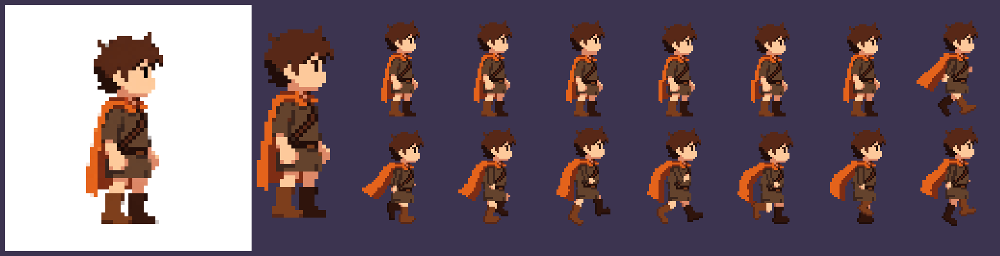

# Test 17 — Personnage animé à partir d'une base Ludo

Le personnage vient d'une image générée par Ludo (pixels de 12 px sur une image 768×768).
La base est relevée telle quelle, puis animée en gardant ses pixels : seul ce qui bouge est redessiné.



| Dossier | Contenu |
|---|---|
| `00_base/` | L'image Ludo, `extraire.py`, la base relevée (`base_brute.txt`, 20×50 px, 11 tons) |
| `01_pieces/` | La base découpée en 6 calques (cape, buste et tête, deux mains, deux jambes). Recomposés, ils redonnent la base au pixel près |
| `02_anim/` | `rig.py` (squelette léger), `repos.py` (6 images), `course.py` (8 images), une grille `.txt` par image, planches et GIF |
| `03_export/` | Planches pour un moteur (cases 48×56, échelle 1), `demo_x4.gif`, `presentation.png` |

## Méthode

- **Repos** : les pixels Ludo ne bougent pas. Le buste descend d'un pixel, la tête suit une image plus tard, puis le bas de la cape. Ce décalage donne de la souplesse.
- **Course** : la tête et le buste restent ceux de Ludo, penchés vers l'avant (tête +2, épaules +1).
  - Jambes, bras et cape sont retracés à partir de points clés : contact, descente, passage, poussée.
  - Le genou est placé par cinématique inverse : longueurs de cuisse et de tibia fixes.
  - Le corps monte et descend d'un pixel, et les bras s'opposent aux jambes.
- **Contrôles** : aucun pixel vide enfermé dans la silhouette, et le sol reste au même rang sur toutes les images.

## Limites

- **Échelle** : le personnage fait 50 px de haut, contre 24 pour celui du kit du test 16 (tuiles de 16). Pour l'utiliser dans ce kit, il faut soit des tuiles de 32, soit une version réduite redessinée.
- **Rendu du rig** : les membres retracés sont plus simples que les pixels Ludo. Il n'y a pas de pli sur la cape en course, et la jupe ne bouge pas. Une passe à la main image par image les rapprocherait du reste.

## Régénérer

```
cd 00_base && python3 extraire.py
cd ../01_pieces && python3 decoupe.py
cd ../02_anim && python3 repos.py && python3 course.py
cd ../03_export && python3 export.py
```
